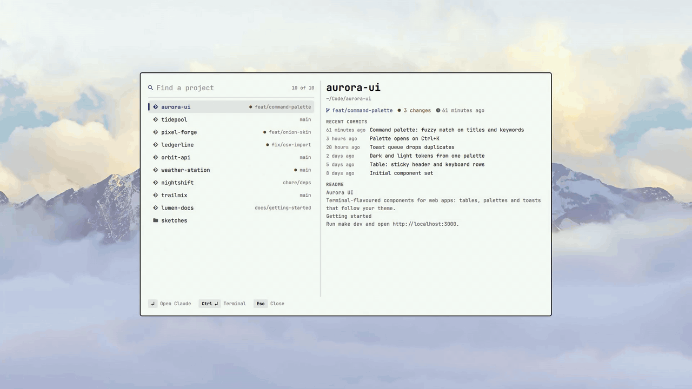

# Hangar

Your projects, parked and ready to roll out. Hangar is a keyboard-first project picker for the [Omarchy](https://omarchy.org) shell: press a key, type a few letters, press Enter, and your coding agent opens in that project.



- Lists every folder in `~/Projects` and `~/Work`, most recently active first
- Shows each project's branch, uncommitted changes, recent commits and README
- **Enter** opens your default coding agent there (`omarchy agent`: Claude Code, Codex, opencode, pi, …)
- **Ctrl+Enter** opens a plain terminal there
- Every pick is a fresh session, so you can run several agents in one project
- Follows your Omarchy theme, fonts and language direction, like the built-in menus


## Requirements

- [Omarchy](https://omarchy.org) 4 or newer (it needs the Omarchy shell's plugin support and the Lua Hyprland config)
- A coding agent, if you want Enter to open one: set it with `omarchy default agent <name>`. Without one, Enter shows Omarchy's agent chooser, and Ctrl+Enter still opens a terminal.

Everything else Hangar uses (`git`, `jq`, a terminal) ships with Omarchy.

## Install

**1. Add the plugin.**

```bash
omarchy plugin add https://github.com/ashtonamory/omarchy-hangar --enable --yes
```

**2. Give it a key.** Open `~/.config/hypr/bindings.lua` and add these two lines at the end. SUPER+P is Omarchy's "Pseudo window" key, so the second line moves that to SUPER+ALT+P:

```lua
o.rebind("SUPER + P", "Hangar", "omarchy-shell shell toggle ashton.hangar")
o.bind("SUPER + ALT + P", "Pseudo window", hl.dsp.window.pseudo())
```

Hyprland reloads when you save. Run `hyprctl configerrors`: no output means the binding is good. If you'd rather use another key, change `SUPER + P` and leave out the second line.

**3. Try it.** Press SUPER+P. Type part of a project's name and press Enter.

If the panel doesn't open, restart the shell once with `omarchy restart shell` and try again.

### Install it with an agent

Paste this into Claude Code, Codex or another coding agent on your Omarchy machine:

> Install the Hangar plugin for the Omarchy shell from https://github.com/ashtonamory/omarchy-hangar. Read its README first. Then:
> 1. Run `omarchy plugin add https://github.com/ashtonamory/omarchy-hangar --enable --yes`.
> 2. Back up `~/.config/hypr/bindings.lua`, then add the two lines from the README's Install section at the end of it, so that SUPER+P runs `omarchy-shell shell toggle ashton.hangar` and "Pseudo window" moves to SUPER+ALT+P. If SUPER+P is already bound to something other than Omarchy's "Pseudo window" in my config, stop and ask me which key to use instead.
> 3. Run `hyprctl configerrors` and fix anything it reports about those lines.
> 4. Run `omarchy plugin list` and confirm `ashton.hangar` is enabled.
> 5. If my project folders are not `~/Projects` or `~/Work`, ask me where they are and write them to `~/.config/omarchy/hangar.json` as `{ "roots": [...] }`.
> Do not press keys or open windows for me. Tell me to press SUPER+P to try it.

### Update or remove

```bash
omarchy plugin update ashton.hangar --yes     # get the latest version
omarchy plugin remove ashton.hangar --yes     # remove it
```

After removing it, delete the SUPER+P lines from `~/.config/hypr/bindings.lua`. After an update, if the bar looks wrong, run `omarchy restart shell`.

## Keys

| Key | Action |
|---|---|
| type | filter by name or branch |
| ↑ ↓ / Ctrl+P Ctrl+N | move |
| Page Up / Page Down | move a page |
| Enter | open your coding agent in the project |
| Ctrl+Enter | open a terminal in the project |
| Esc | clear the filter, then close |

## Project folders

By default the panel lists `~/Projects` and `~/Work`. To choose your own, create `~/.config/omarchy/hangar.json`:

```json
{ "roots": ["~/Projects", "~/code", "~/Work"] }
```

## Scripting

```bash
omarchy-shell shell toggle ashton.hangar        # show or hide the panel
omarchy-shell ashton.hangar open my-app         # agent in ~/Projects/my-app
omarchy-shell ashton.hangar terminal my-app     # terminal there
omarchy-shell ashton.hangar search api          # open the panel already filtered
```

`open`, `terminal` and `search` work once the panel has been shown at least once since the shell started.

## Extra: a session headline for Claude Code

`extras/claude-statusline.sh` is a Claude Code status line that keeps the session's name at the bottom of every session, with the project, branch, model and context use beside it. With several agents open in one project, the name tells them apart.

```bash
mkdir -p ~/.claude/statusline
curl -fsSL https://raw.githubusercontent.com/ashtonamory/omarchy-hangar/main/extras/claude-statusline.sh \
  -o ~/.claude/statusline/headline.sh
```

Then add this to `~/.claude/settings.json`:

```json
"statusLine": { "type": "command", "command": "bash ~/.claude/statusline/headline.sh", "padding": 0 }
```

Name a session with `claude -n "…"` or `/rename …`. Otherwise Claude titles it for you.

## Screenshots

The README images are made from fake projects: `scripts/demo-projects.sh` builds them in `~/Code`, and `~/.config/omarchy/hangar.json` with `{ "roots": ["~/Code"] }` points Hangar at them.

## License

MIT
