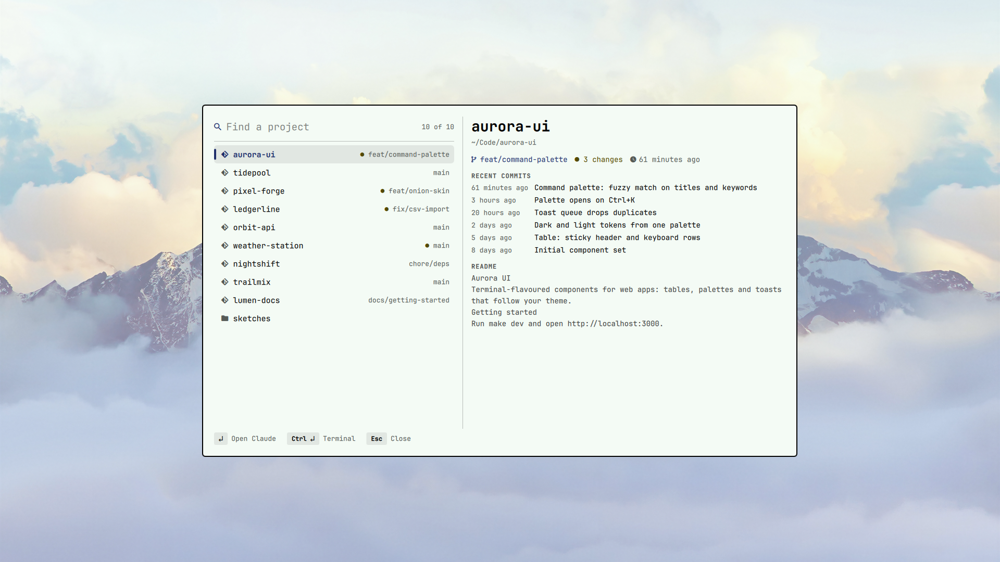

# Hangar

Your projects, parked and ready to roll out. Hangar is a keyboard-first project picker for the [Omarchy](https://omarchy.org) shell: press a key, type a few letters, press Enter, and your coding agent opens in that project.


- Lists every folder in `~/Projects` and `~/Work`, most recently active first
- Shows each project's branch, uncommitted changes, recent commits and README
- **Enter** opens your default coding agent there (`omarchy agent`: Claude Code, Codex, opencode, pi, …)
- **Ctrl+Enter** opens a plain terminal there
- Every pick is a fresh session, so you can run several agents in one project
- Follows your Omarchy theme, fonts and language direction, like the built-in menus



## Install

```bash
omarchy plugin add https://github.com/ashtonamory/omarchy-hangar --enable
```

Then bind a key in `~/.config/hypr/bindings.lua`. SUPER+P is Omarchy's "Pseudo window" by default, so move that first:

```lua
o.rebind("SUPER + P", "Hangar", "omarchy-shell shell toggle ashton.hangar")
o.bind("SUPER + ALT + P", "Pseudo window", hl.dsp.window.pseudo())
```

Pick your agent with `omarchy default agent <name>`. If none is set, Enter opens Omarchy's agent chooser.

## Keys

| Key | Action |
|---|---|
| type | filter by name or branch |
| ↑ ↓ / Ctrl+P Ctrl+N | move |
| Page Up / Page Down | move a page |
| Enter | open your coding agent in the project |
| Ctrl+Enter | open a terminal in the project |
| Esc | clear the filter, then close |

## Project folders

By default the panel lists `~/Projects` and `~/Work`. To choose your own, create `~/.config/omarchy/hangar.json`:

```json
{ "roots": ["~/Projects", "~/code", "~/Work"] }
```

## Scripting

```bash
omarchy-shell shell toggle ashton.hangar        # show or hide the panel
omarchy-shell ashton.hangar open my-app         # agent in ~/Projects/my-app
omarchy-shell ashton.hangar terminal my-app     # terminal there
omarchy-shell ashton.hangar search api          # open the panel already filtered
```

## Extra: a session headline for Claude Code

`extras/claude-statusline.sh` is a Claude Code status line that keeps the session's name at the bottom of every session, with the project, branch, model and context use beside it. With several agents open in one project, the name tells them apart.

```bash
mkdir -p ~/.claude/statusline
cp extras/claude-statusline.sh ~/.claude/statusline/headline.sh
```

Then add this to `~/.claude/settings.json`:

```json
"statusLine": { "type": "command", "command": "bash ~/.claude/statusline/headline.sh", "padding": 0 }
```

Name a session with `claude -n "…"` or `/rename …`. Otherwise Claude titles it for you.

## Screenshots

The README images are made from fake projects: `scripts/demo-projects.sh` builds them in `~/Code`, and `~/.config/omarchy/hangar.json` with `{ "roots": ["~/Code"] }` points Hangar at them.

## License

MIT
